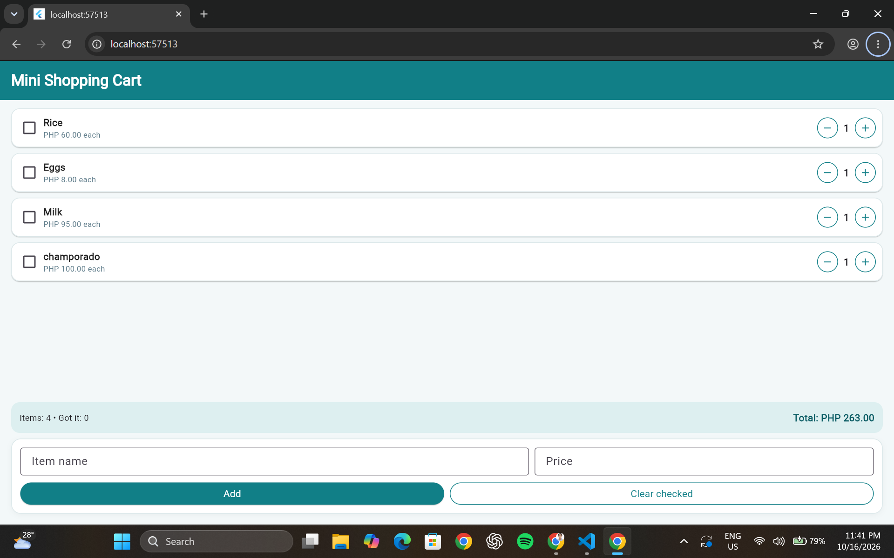

# Mini Shopping Cart with StatefulWidget

## Laboratory Activity No. 3

**Name:** Ram Andre Fervis  
**Course:** Bachelor of Science in Information Technology (BSIT)

## Project Description

The Mini Shopping Cart is a Flutter application developed to demonstrate state management using `StatefulWidget`, `StatelessWidget`, and `setState()`. It allows users to manage shopping items, adjust quantities, mark items as collected, add new products, and view the total shopping cost.

## Features

- Preloaded shopping items: Rice, Eggs, and Milk.
- Increase and decrease item quantities.
- Enforce a minimum quantity of 1 and a maximum quantity of 99.
- Mark items as collected using checkboxes.
- Display checked items with strikethrough text.
- Automatically calculate the total shopping cost.
- Display the total number of items and checked items.
- Add new items using an item name and price.
- Validate item names and prices before adding.
- Display feedback when adding items or clearing checked items.
- Remove all checked items from the shopping cart.
- Manage widget lifecycle using `initState()` and `dispose()`.

## Technologies Used

- Flutter
- Dart
- Material Design

## Sample Shopping Items

| Item | Price | Quantity |
|---|---:|---:|
| Rice | PHP 60.00 | 2 |
| Eggs | PHP 8.00 | 12 |
| Milk | PHP 95.00 | 1 |

## Application Screenshot



## How to Run the Application

1. Install Flutter and configure the Flutter development environment.
2. Clone this repository or download the project files.
3. Open the project folder in Visual Studio Code.
4. Open the terminal in the project folder.
5. Install the project dependencies:

   ```bash
   flutter pub get
   ```

6. Run the application:

   ```bash
   flutter run
   ```

## Learning Objectives

- Understand state management using `StatefulWidget`.
- Use `setState()` to update the user interface when cart data changes.
- Build reusable UI components using `StatelessWidget`.
- Handle user input and validate form fields.
- Calculate and display updated shopping totals.
- Understand widget lifecycle methods, including `initState()` and `dispose()`.
- Use Git and GitHub for version control and project submission.

## Author

**Ram Andre Fervis**

Bachelor of Science in Information Technology (BSIT)